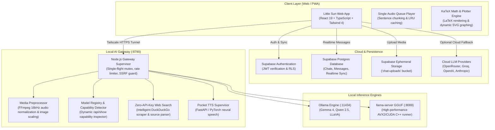

# Little Sun ☀️ — Sovereign Multimodal Intelligence

> **A sovereign, minimal, and personal intelligence interface bridging local hardware inference (Ollama & llama.cpp), multimodal vision & audio pipelines, neural text-to-speech, zero-API-key web search, and hybrid cloud models.**

[](https://opensource.org/licenses/MIT)
[]()
[](https://www.typescriptlang.org/)
[](https://react.dev/)
[](https://tailwindcss.com/)
[](https://vitejs.dev/)
[](https://ollama.com/)
[](https://tailscale.com/)
[](https://supabase.com/)

---

## 🏛️ System Architecture



---

## ✨ Core Highlights

- **Sovereign Local Inference**: Seamless orchestration between **Ollama** and **llama-server (llama.cpp)** with automatic cold-start loading, active request tracking, and configurable idle auto-unloading.
- **Multimodal Vision & Audio**: Model-agnostic preprocessing for images, multi-format audio (resampled to 16 kHz mono WAV with automatic 30s chunking), and text documents (`.py`, `.ts`, `.json`, `.csv`, `.md`).
- **Interactive Math & Graphing**: Native LaTeX rendering via KaTeX with automatic mathematical expression detection and interactive dynamic SVG function graphing.
- **1-Click File Generation**: Delivers code and formatted files (`.doc`, `.csv`, `.srt`, `.json`, `.html`, `.svg`) with inline download, copy, and syntax-highlighted preview.
- **Neural Text-to-Speech**: Integrated Pocket TTS supervisor with sentence-by-sentence streaming, client-side LRU audio caching, and variable playback speeds (0.75x – 1.5x).
- **Zero-API-Key Web Search**: Intelligent real-time web search with source attribution cards without requiring third-party search API keys.
- **Airtight Privacy & Security**: Non-recording logging policy (prompts and answers excluded), SSRF IP-range validation for remote media staging, and strict Supabase Row-Level Security (RLS).

---

## 🚀 One-Click Quick Start

### Windows

1. **Launch Web Client**:
   Double-click `start.bat` (or run `start_web_dev.bat`). Installs dependencies on first run and starts `http://localhost:3000`.
2. **Launch Local AI Gateway**:
   Double-click `start_gateway.bat` (or `little-sun-gateway\start_little_sun.bat`). Starts the local supervisor on `http://127.0.0.1:8790`.

### Linux / macOS

1. **Launch Web Client**:
   ```bash
   chmod +x start.sh start_gateway.sh little-sun-gateway/start_little_sun.sh
   ./start.sh
   ```
2. **Launch Local AI Gateway**:
   ```bash
   ./start_gateway.sh
   ```

---

## 🛠️ Step-by-Step Manual Setup

### 1. Prerequisites

- **Node.js**: v20.0.0 or higher ([Download Node.js](https://nodejs.org/))
- **Git**: ([Download Git](https://git-scm.com/))
- **FFmpeg & FFprobe**: Required for media normalization.
  - Windows: `winget install Gyan.FFmpeg`
  - macOS: `brew install ffmpeg`
  - Linux (Ubuntu/Debian): `sudo apt update && sudo apt install -y ffmpeg`
- **Tailscale** *(optional for remote access)*: Enables secure HTTPS cross-device synchronization ([Tailscale](https://tailscale.com/)).

### 2. Configure Environment Variables

Copy the example configuration files and fill in your Supabase project parameters:

```bash
# Root client environment
cp .env.example .env

# Gateway supervisor environment
cp little-sun-gateway/.env.example little-sun-gateway/.env
```

Edit `.env`:
```ini
VITE_SUPABASE_URL=https://<your-project>.supabase.co
VITE_SUPABASE_ANON_KEY=your-supabase-anon-key
VITE_GATEWAY_URL=http://127.0.0.1:8790
```

Edit `little-sun-gateway/.env`:
```ini
PORT=8790
SUPABASE_URL=https://<your-project>.supabase.co
OWNER_EMAIL=you@example.com
ALLOWED_EMAILS=you@example.com
ALLOWED_ORIGINS=http://localhost:3000,http://localhost:5173
LLAMA_PORT=8089
IDLE_UNLOAD_SECONDS=60
```

### 3. Initialize Supabase Database & Storage

1. Go to your [Supabase Dashboard](https://supabase.com/dashboard) and open the **SQL Editor**.
2. Run the script located in [`supabase/schema.sql`](supabase/schema.sql).
3. This creates:
   - `chats` and `messages` tables with full Row-Level Security (RLS).
   - Realtime replication publication for multi-tab sync.
   - `chat-uploads` storage bucket with ephemeral upload policies.

### 4. Install Dependencies & Build

```bash
# Install root client dependencies
npm install

# Build production assets
npm run build

# Install gateway dependencies
cd little-sun-gateway
npm install
cd ..
```

---

## 📡 Gateway API Specifications

The Little Sun Gateway operates on port `8790` (or your configured `PORT`) and exposes the following endpoints:

| Endpoint | Method | Auth | Description |
|---|---|---|---|
| `/health` | `GET` | None | Instant gateway reachability check. Returns `200 { ok: true, version, uptime }`. |
| `/status` | `GET` | Bearer JWT | Detailed supervisor telemetry (funnel URL, TTS status, model process status, active request counts). |
| `/models` | `GET` | Bearer JWT | List of configured and detected local models, modalities (`text`, `image`, `audio`), context sizes, and projector status. |
| `/chat` | `POST` | Bearer JWT | SSE stream endpoint for LLM completion with multimodal attachments, reasoning trace, and live web search. |
| `/tts` | `POST` | Bearer JWT | Direct audio synthesis endpoint returning single audio buffer (`audio/wav`). |
| `/tts/stream` | `POST` | Bearer JWT | SSE streaming text-to-speech emitting sequential sentence-chunked Base64 WAV blocks. |
| `/session/switch`| `POST` | Bearer JWT | Session state manager (`sleep`, `wake`, `kill`) to manage background inference processes. |

### SSE `/chat` Stream Event Protocol

```json
// Reasoning token
data: {"type": "thinking", "chunk": "Analyzing input constraints..."}

// Answer token
data: {"type": "token", "token": "Hello! "}

// Tool execution notification
data: {"type": "tool_start", "name": "search_web", "query": "current space mission"}

// Stream completion
data: {"type": "done", "tokens": 142}
```

---

## 📂 Repository File Map

```
little-sun/
├── .github/workflows/          # Automated GitHub Actions (keepalive workflows)
├── little-sun-gateway/          # Local AI Gateway & Process Supervisor
│   ├── adapters/
│   │   ├── backend-adapters.mjs # Decoupled Ollama & llama-server streaming adapters
│   │   ├── media-preprocessor.mjs # 16kHz audio normalization & image scaling
│   │   └── model-registry.mjs   # Dynamic capability detection & envelopes
│   ├── models/                  # Local GGUFs and companion mmproj files
│   ├── auth.mjs                 # Supabase JWT authentication & email filtering
│   ├── cli-dashboard.mjs        # TTY terminal dashboard and live event inspector
│   ├── download_llama.bat       # Official llama-server binary downloader
│   ├── download_projector.mjs   # Multimodal projector manager & Hugging Face downloader
│   ├── llama-manager.mjs        # Mutex-locked llama-server process supervisor
│   ├── logger.mjs               # Privacy-focused session logger
│   ├── models.json              # Local model configuration & templates
│   ├── package.json             # Gateway dependencies & scripts
│   ├── requirements.txt         # Optional Python dependencies (Pocket-TTS)
│   ├── server.mjs               # Hardened HTTP/SSE Gateway server (50MB limit)
│   ├── start_little_sun.bat     # Gateway launcher (Windows)
│   ├── start_little_sun.sh      # Gateway launcher (Linux / macOS)
│   └── tts-proxy.mjs            # Pocket TTS supervisor & audio proxy
├── public/                      # Static assets, PWA icons, manifest
├── src/                         # React 19 Frontend Web Client
│   ├── components/              # ChatView, Composer, MathVisualizer, MediaViewer, Sidebar
│   ├── lib/                     # Gateway client, Supabase, Web search, TTS controller
│   ├── pages/                   # Chat, Login, Settings views
│   ├── state/                   # App state store with cross-chat race protection
│   └── styles/                  # Tailwind CSS tokens and themes
├── supabase/
│   └── schema.sql               # Idempotent database schema & storage bucket rules
├── LICENSE                      # MIT License
├── package.json                 # Pinned dependencies & build scripts
├── server.ts                    # Production Express reverse proxy & Vite middleware
├── start.bat                    # One-click Windows Web Launcher
├── start.sh                     # One-click Unix Web Launcher
├── start_gateway.bat            # One-click Windows Gateway Launcher
├── start_gateway.sh             # One-click Unix Gateway Launcher
└── vite.config.ts               # Vite 8 build & bundler configuration
```

---

## 📄 License

This project is licensed under the [MIT License](LICENSE).  
Copyright (c) 2026 Little Sun Contributors.
